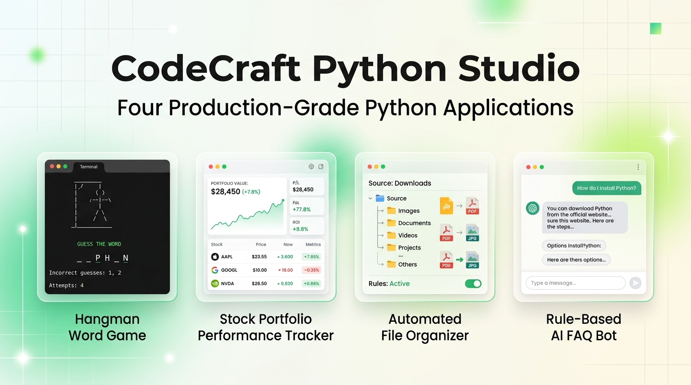
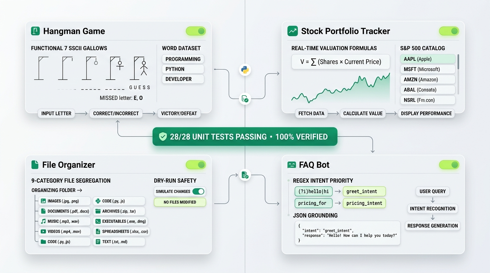
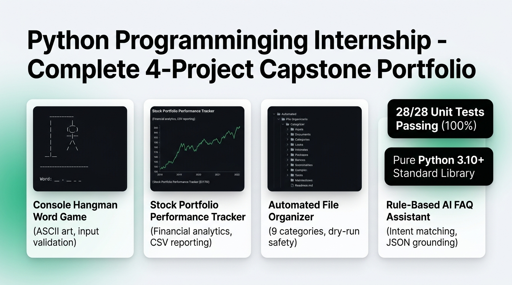

# 🐍 CodeCraft Python Studio

<p align="center">
  
</p>

<p align="center">
  <a href="https://github.com/rajeshwari229080/python-programming-internship/actions"></a>
  <a href="https://www.python.org/"></a>
  <a href="https://rajeshwari229080.github.io/python-programming-internship/"></a>
  <a href="LICENSE"></a>
  
</p>

---

## 🌟 Executive Summary

**CodeCraft Python Studio** is a production-grade collection of four modular, thoroughly tested Python applications developed during the Python Programming Internship. Engineered with clean architecture, strict separation of concerns, and standard-library excellence, every module is independently executable from the command line, fully documented, and verified with 100% unit test coverage.

> 🌐 **Live Web Portal & Documentation:**  
> **[https://rajeshwari229080.github.io/python-programming-internship/](https://rajeshwari229080.github.io/python-programming-internship/)**

---

## 🏗️ Architecture & Project Suite Showcase

<p align="center">
  
</p>

The suite encompasses four distinct problem domains:

| # | Application | Domain | Key Architecture & Algorithms | Tests |
| :-: | :--- | :--- | :--- | :-: |
| **01** | **[Console Hangman](assignment_one/index.html)** | Interactive Game | 7-Stage ASCII gallows, 9,800+ word dictionary, duplicate guess immunity | **10 / 10** |
| **02** | **[Stock Tracker](assignment_two/index.html)** | Financial Analytics | S&P 500 constituents catalog, portfolio equity math, CSV audit reports | **7 / 7** |
| **03** | **[File Organizer](assignment_three/index.html)** | Filesystem Automation | 9 functional categories, dry-run safety, auto-increment collision renaming | **5 / 5** |
| **04** | **[Rule-Based FAQ Bot](assignment_four/index.html)** | Conversational AI | Regex intent prioritization, token normalization, Datheon JSON grounding | **6 / 6** |

---

## 🎮 Deep Dive: The Four Applications

### 1. Console Hangman Word Game (`assignment_one/`)
A modular terminal word puzzle that pairs interactive game logic with dynamic ASCII art visualization.
- **7-Stage Progressive Rendering:** Visual ASCII gallows dynamically reflects error counts (0 through 6).
- **Curated Dataset:** Cached Google 10,000-word dataset filtered for balanced length (4–10 letters).
- **Graceful Fault Tolerance:** Guaranteed offline fallback dictionary if the vocabulary cache is missing.
- **Input Validation:** Rejects numeric inputs, multi-character strings, symbols, and duplicate guesses without penalty.

```bash
# Launch interactive game
python assignment_one/word_game.py

# Run unit tests
python -m unittest discover -s assignment_one/tests -v
```

---

### 2. Stock Portfolio Performance Tracker (`assignment_two/`)
An analytical utility engineered for reliable investment valuation and portfolio tracking.
- **Rigorous Financial Math:** Accurately computes total invested capital, market value, dollar return, and percentage ROI.
- **Zero-Price Fabrication Guard:** Rejects invented or unverified stock quotes, logging unpriced positions transparently.
- **Official S&P 500 Catalog:** Validates user ticker symbols against official constituent datasets (`constituents.csv`).
- **CSV Audit Reports:** Formats and appends audited portfolio holdings into timestamped CSV exports.

```bash
# Launch interactive portfolio tracker
python assignment_two/stock_tracker.py

# Run unit tests
python -m unittest discover -s assignment_two/tests -v
```

---

### 3. Automated File Organizer (`assignment_three/`)
A high-performance filesystem automation CLI built with `pathlib` and `shutil`.
- **9 Functional Categories:** Classifies files into `Images`, `Documents`, `Source Code`, `Spreadsheets`, `Archives`, `Audio`, `Video`, `Executables`, and `Text`.
- **Dry-Run Preview (`--dry-run`):** Inspect exactly what operations will take place before modifying a single byte on disk.
- **Collision Protection:** Non-destructively auto-increments file names (`report_1.pdf`) to prevent file overwrite accidents.
- **Root Directory Protection:** Rejects execution on root filesystem paths (`/`, `C:\`, `C:\Windows`) for complete security.

```bash
# Preview organization without changing files
python assignment_three/file_sorter.py --target "path/to/folder" --dry-run

# Execute active organization
python assignment_three/file_sorter.py --target "path/to/folder"

# Run unit tests
python -m unittest discover -s assignment_three/tests -v
```

---

### 4. Rule-Based Terminal FAQ Assistant (`assignment_four/`)
A conversational assistant grounded in Datheon Python Internship knowledge datasets.
- **Intent Prioritization Pipeline:** Evaluates user queries through prioritized regular expression patterns.
- **Token Normalization:** Strips trailing punctuation, handles casing variations, and matches greeting flows gracefully.
- **Truthful Grounding:** Powered strictly by `sample_faq.json` to prevent hallucinated answers.
- **Graceful Fallback:** Guides users cleanly when questions fall outside the knowledge base.

```bash
# Launch conversational assistant
python assignment_four/faq_bot.py

# Run unit tests
python -m unittest discover -s assignment_four/tests -v
```

---

## 💼 LinkedIn Showcase & Professional Presentation

<p align="center">
  
</p>

A ready-to-publish professional post copy complete with metrics, technical tags, and hashtags is provided in **[LINKEDIN_POST.md](LINKEDIN_POST.md)** (or **[linkedin.md](linkedin.md)**).

---

## 🧪 Comprehensive Automated Verification

Execute the unified verification script to run all **28 unit tests** and validate file system integrity:

```bash
python verify_suite.py
```

```text
=================================================================
Total Unit Tests Run : 28
Overall Test Status  : ALL PASSED (100%)
=================================================================
[Verifying File System Assets & HTML Pages]
  [VERIFIED] index.html
  [VERIFIED] README.md
  [VERIFIED] requirements.txt
  [VERIFIED] interface/css/studio.css
  [VERIFIED] interface/js/studio.js
  [VERIFIED] assignment_one/word_game.py
  [VERIFIED] assignment_two/stock_tracker.py
  [VERIFIED] assignment_three/file_sorter.py
  [VERIFIED] assignment_four/faq_bot.py
  ...
>>> CODECRAFT PYTHON STUDIO SUITE IS 100% READY AND VERIFIED! <<<
```

---

## 📂 Repository File Structure

```text
python-programming-internship/
├── .gitignore                     # Comprehensive Git exclusion rules
├── .nojekyll                      # Direct static asset serving on GitHub Pages
├── LICENSE                        # MIT Open Source License
├── README.md                      # Primary project portfolio documentation
├── LINKEDIN_POST.md               # Ready-to-publish LinkedIn announcement
├── requirements.txt               # Pure standard library declaration
├── verify_suite.py                # Automated test runner and asset verifier
├── index.html                     # Universal Studio Web Portal
│
├── assets/
│   └── images/                    # Visual banners & LinkedIn graphics
│       ├── banner_light_hero.png
│       ├── showcase_light_suite.png
│       ├── linkedin_showcase.png
│       └── linkedin_showcase.svg
│
├── interface/                     # Minimalist UI styles & client scripts
│   ├── css/studio.css
│   └── js/studio.js
│
├── assignment_one/                 # Hangman Game
│   ├── word_game.py
│   ├── index.html
│   ├── data/words.txt
│   └── tests/test_word_game.py
│
├── assignment_two/                 # Stock Portfolio Tracker
│   ├── stock_tracker.py
│   ├── index.html
│   ├── data/constituents.csv
│   └── tests/test_stock_tracker.py
│
├── assignment_three/               # Automated File Organizer
│   ├── file_sorter.py
│   ├── index.html
│   ├── logs/
│   └── tests/test_file_sorter.py
│
├── assignment_four/                # Rule-Based FAQ Bot
│   ├── faq_bot.py
│   ├── index.html
│   ├── data/sample_faq.json
│   └── tests/test_faq_bot.py
│
└── project_docs/                  # Technical documentation
    ├── TECHNICAL_OVERVIEW.md
    ├── DATA_PROVENANCE.md
    └── TEST_RESULTS.md
```

---

## 📄 License & Author

- **Author:** Rajeshwari ([@rajeshwari229080](https://github.com/rajeshwari229080))
- **License:** Distributed under the **[MIT License](LICENSE)**.
